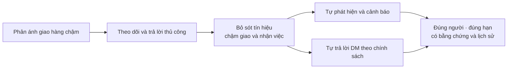
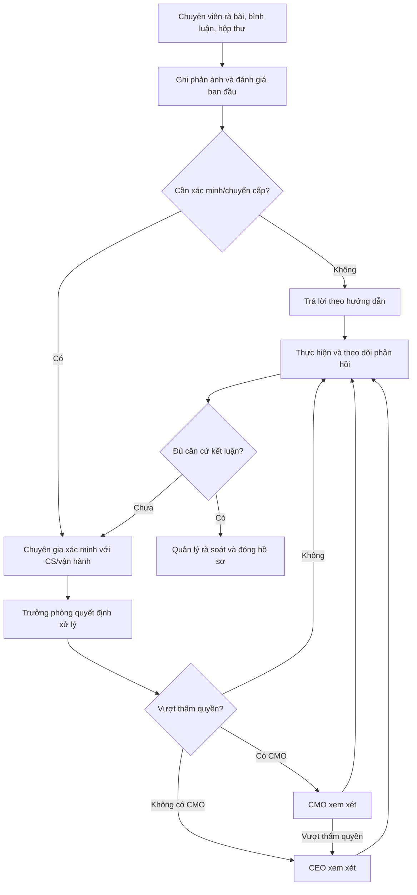
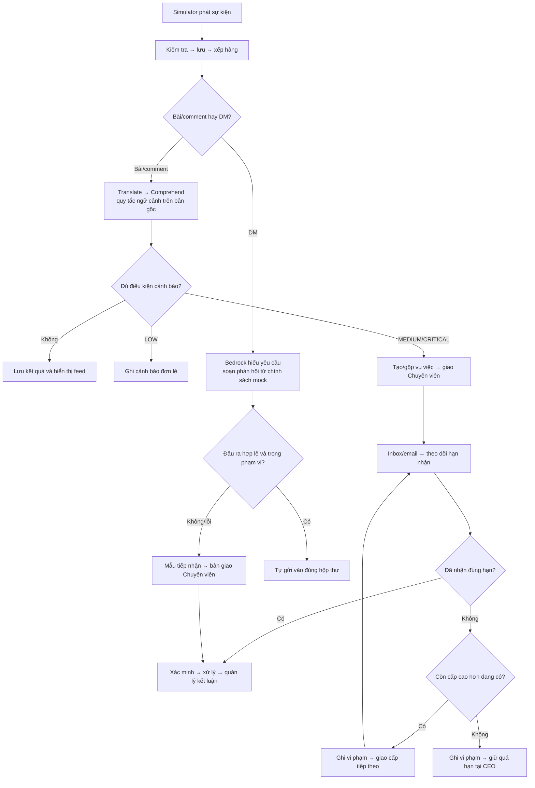
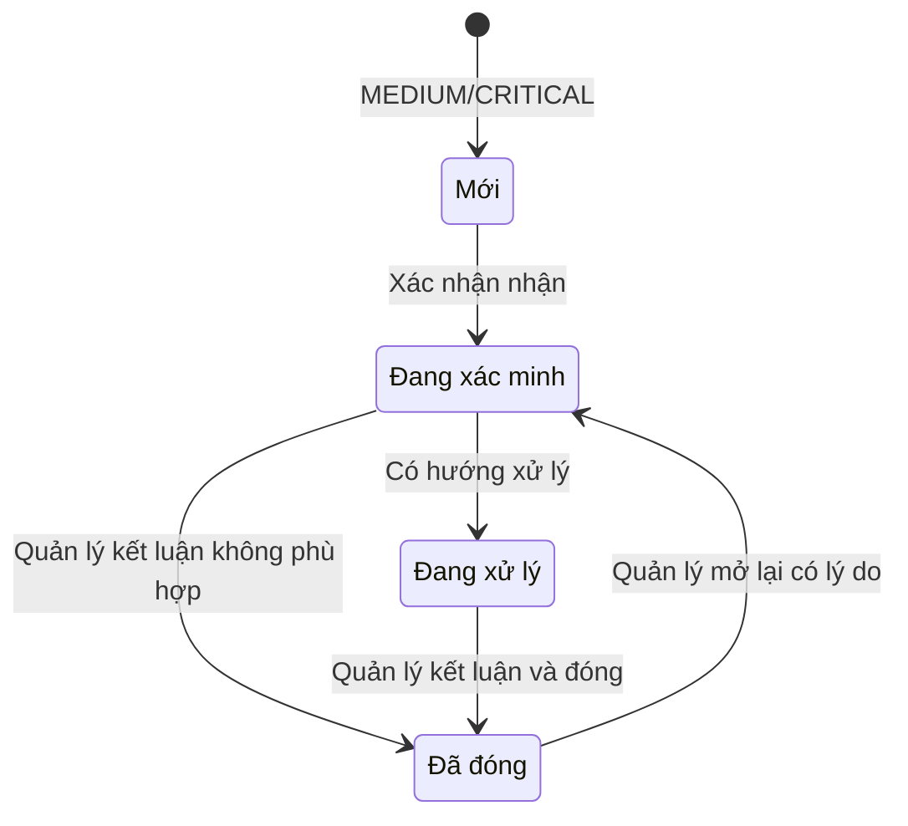
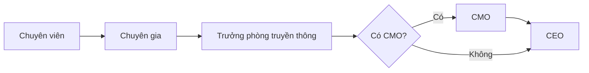
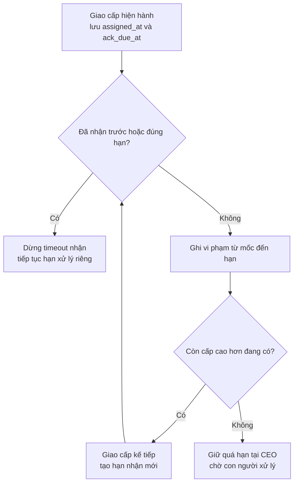
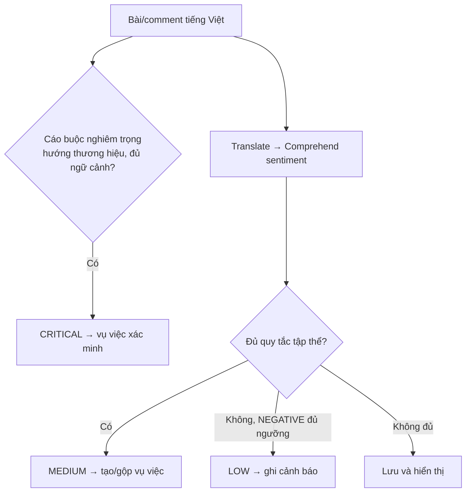
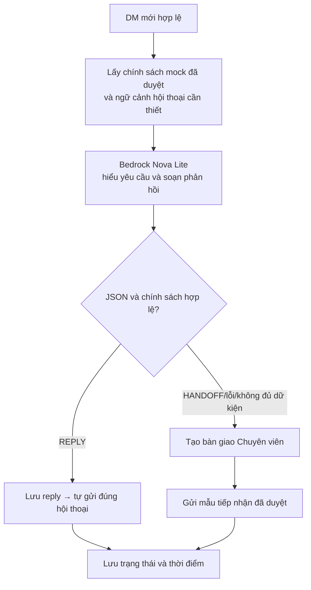
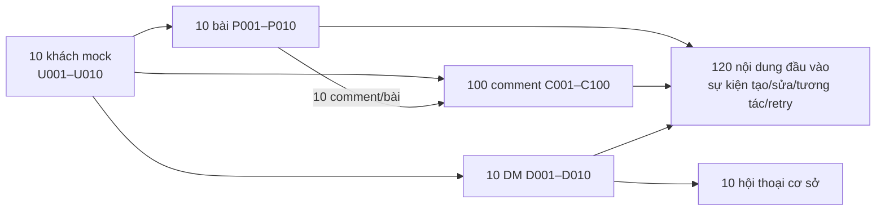

# Business Requirements Document — Brand Listening and Crisis Alert

| Thuộc tính | Nội dung |
| --- | --- |
| Phiên bản tài liệu | 2.0 |
| Sản phẩm | Phân tích Dư luận và Cảnh báo Sớm — v0.1 |
| Cập nhật | 08/10/2026 |
| Đối tượng | Doanh nghiệp vừa và nhỏ; một thương hiệu bán lẻ mô phỏng |
| Bài toán | Nhận biết phản ánh giao hàng chậm; cảnh báo và xử lý nguy cơ truyền thông; tự trả lời tin nhắn khách hàng |
| Dữ liệu | 10 khách, 10 bài, 100 bình luận, 10 DM; hoàn toàn giả lập |
| Nguồn lực | 5 thành viên, 5 tuần thực hiện chính; 200 USD tổng ngân sách |
| Hạn nộp / trình bày | 29/11/2026 |
| Trạng thái | Tài liệu yêu cầu phục vụ review nhóm và triển khai v0.1 |
| Tài liệu liên quan | [PROJECT_SPEC](PROJECT_SPEC.md), [GLOSSARY](GLOSSARY.md), [DATA_SOURCE](DATA_SOURCE.md), [AGENTS](AGENTS.md) |

## I. Terminology and Document Scope

*Thuật ngữ, mã định danh và phạm vi sử dụng tài liệu.*

### 1. Abbreviations — Chữ viết tắt

| Ký hiệu | English expansion | Ý nghĩa |
| --- | --- | --- |
| BRD | Business Requirements Document | Tài liệu yêu cầu nghiệp vụ |
| AI | Artificial Intelligence | Trí tuệ nhân tạo |
| LLM | Large Language Model | Mô hình ngôn ngữ lớn |
| SME | Small and Medium-sized Enterprise | Doanh nghiệp vừa và nhỏ |
| DM | Direct Message | Tin nhắn riêng |
| CS | Customer Service | Chăm sóc khách hàng |
| CMO | Chief Marketing Officer | Giám đốc Marketing, tùy chọn theo doanh nghiệp |
| CEO | Chief Executive Officer | Giám đốc điều hành |
| SLA | Service Level Agreement | Mức dịch vụ, trách nhiệm và xử lý quá hạn |
| SLO / SLI | Service Level Objective / Service Level Indicator | Mục tiêu dịch vụ / chỉ số thực đo |
| P95 | 95th Percentile | Phân vị 95 |
| API | Application Programming Interface | Giao diện tích hợp |
| HTTP | Hypertext Transfer Protocol | Giao thức giao tiếp API |
| JSON / JSONL | JavaScript Object Notation / JSON Lines | Đối tượng JSON / mỗi dòng một đối tượng JSON |
| JWT | JSON Web Token | Token xác thực API |
| ID | Identifier | Định danh |
| AWS | Amazon Web Services | Nền tảng đám mây |
| IAM | Identity and Access Management | Định danh và phân quyền AWS |
| S3 | Simple Storage Service | Lưu trữ đối tượng |
| SQS / SNS | Simple Queue Service / Simple Notification Service | Hàng đợi / dịch vụ thông báo |
| FIFO | First In, First Out | Xử lý theo thứ tự trong nhóm |
| DLQ | Dead-Letter Queue | Hàng đợi sự kiện lỗi |
| SHA | Secure Hash Algorithm | Thuật toán băm; SHA-256 tạo định danh 256 bit |
| UTC | Coordinated Universal Time | Chuẩn thời gian đối chiếu |
| USD | United States Dollar | Đơn vị ngân sách |
| MCP | Model Context Protocol | Giao thức kết nối công cụ; hướng tích hợp tương lai |

### 2. Business Definitions — Khái niệm nghiệp vụ

| Khái niệm | Định nghĩa trong v0.1 |
| --- | --- |
| Phản hồi bất lợi | Ý kiến hoặc trải nghiệm xấu liên quan thương hiệu; một phản ánh đơn lẻ chưa đủ kết luận khủng hoảng |
| Cảnh báo | Kết quả phát hiện có mức độ, lý do, thời điểm và nội dung làm căn cứ |
| Vụ việc | Hồ sơ để giao, nhận, xác minh, xử lý và kết luận; có thể chứa nhiều cảnh báo |
| Thông báo | Thông tin gửi tới người phụ trách qua inbox/email; không thay hành động xác nhận nhận việc |
| Chuyển cấp | Chuyển trách nhiệm tới cấp cao hơn do chưa nhận đúng hạn hoặc vượt thẩm quyền |
| Sentiment | Sắc thái POSITIVE, NEGATIVE, NEUTRAL hoặc MIXED; không xác nhận cáo buộc đúng hay sai |
| Tự trả lời | Hệ thống kiểm tra và gửi phản hồi vào hộp thư mock, không chỉ tạo bản nháp |
| Mock data | Danh tính và nội dung chuẩn bị sẵn; kết quả AI trong demo chính được xử lý thực tại runtime |
| Event Contract | Cấu trúc, ý nghĩa và quy tắc xử lý sự kiện giữa simulator và backend |

*BO-S: Business Objective — Simplified Scope, mục tiêu nghiệp vụ. BR-S: Business Requirement — Simplified Scope, yêu cầu nghiệp vụ. AC-S: Acceptance Criterion — Simplified Scope, tiêu chí nghiệm thu. DG-S: Diagram — Simplified Scope, sơ đồ. Mã hiện hành giữ ổn định để truy vết giữa các tài liệu.*

## II. Business Context and Product Scope

*Tập trung một vấn đề của thương hiệu, hai luồng tự động hóa và trách nhiệm xử lý rõ ràng.*

### 1. Business Problem — Vấn đề nghiệp vụ



*DG-S01: Business problem — Vấn đề và kết quả cần đạt.*

| Vấn đề | Ảnh hưởng | Năng lực cần có |
| --- | --- | --- |
| Nội dung rải rác | Bỏ sót diễn biến tập thể | Tập trung bài/bình luận và căn cứ phát hiện |
| Đánh giá thiếu thống nhất | Không phân biệt bất mãn đơn lẻ và nguy cơ nghiêm trọng | Quy tắc LOW/MEDIUM/CRITICAL |
| Chuyển việc thủ công | Không rõ ai đang giữ việc, đã quá hạn hay chưa | Chủ sở hữu, SLA, chuyển cấp và lịch sử |
| Câu hỏi khách hàng lặp lại | Phản hồi chậm, chuyên viên mất thời gian | LLM trả lời trong phạm vi chính sách |
| SME thiếu chức danh | Quy trình chờ người không tồn tại | CMO tùy chọn; bỏ qua cấp không có |
| AI hoặc dữ liệu sai | Phản hồi thiếu căn cứ | Kiểm tra đầu ra và bàn giao con người |

### 2. Business Objectives — Mục tiêu nghiệp vụ

| ID | Mục tiêu | Kết quả demo |
| --- | --- | --- |
| BO-S01 | Tập trung phản ánh thương hiệu | Đủ 10 bài/100 bình luận, đúng tác giả và bài cha |
| BO-S02 | Phát hiện tín hiệu nguy cơ | Cảnh báo có lý do, mức độ và bằng chứng |
| BO-S03 | Giao và nhận đúng trách nhiệm | Theo dõi hạn nhận, quá hạn và chuyển cấp |
| BO-S04 | Phản hồi nhu cầu đơn giản | DM được trả tự động hoặc chuyển Chuyên viên |
| BO-S05 | Hoàn thành bài tập trong nguồn lực | Hai luồng trên AWS, đủ minh chứng dịch vụ và chi phí |

### 3. Scope Boundaries — Ranh giới sản phẩm

| Trong v0.1 | Ngoài v0.1 |
| --- | --- |
| Một SME, thương hiệu giả `DemoBrandA` | Đa doanh nghiệp, thanh toán và thương mại hóa hoàn chỉnh |
| Giao chậm là vấn đề chính; đổi trả/hoàn tiền là nhóm phản ánh phụ | Quản lý đơn hàng hoặc hoàn tiền thật |
| 10 khách cơ sở; simulator hỗ trợ cấu hình 10–20 khách | Thu thập tài khoản hoặc dữ liệu cá nhân thật |
| 10 bài, 10 comment/bài, 10 DM đầu vào | Bình luận lồng nhiều cấp, ảnh/video, thu thập nguồn thật |
| Giám sát bài/comment; tự trả lời DM | Tự trả lời bình luận công khai hoặc tự phát ngôn về cáo buộc |
| Nhận/xác minh/xử lý/đóng vụ việc; năm cấp trách nhiệm | Hệ thống nhân sự hoặc phê duyệt văn bản truyền thông đầy đủ |
| Dashboard feed, cảnh báo, vụ việc, hộp thư và SLA | Phân tích chiến dịch, báo cáo nhiều thương hiệu |
| Minh chứng chức năng, lỗi, quyền và thời gian | Đánh giá AI tổng quát hoặc cam kết vận hành 24/7 |

## III. Current State — As-Is

*Mô hình nghiệp vụ tham chiếu của SME; không phải số liệu khảo sát một doanh nghiệp cụ thể.*

### 1. Current Workflow — Quy trình hiện tại



*DG-S02: As-Is workflow — Cấp trên tham gia khi cần chuyên môn, thẩm quyền hoặc xử lý quá hạn.*

| Bước | Chủ trì | Đầu ra | Khoảng trống |
| --- | --- | --- | --- |
| Theo dõi | Chuyên viên | Nội dung liên quan thương hiệu | Rà nhiều nguồn thủ công |
| Ghi nhận/đánh giá | Chuyên viên | Phản ánh, bằng chứng, ưu tiên ban đầu | Thiếu số liệu và tiêu chí nhất quán |
| Xác minh | Chuyên gia + CS/vận hành | Dữ kiện đã biết, phần thiếu, hướng xử lý | Chờ phối hợp, khó theo dõi thời hạn |
| Quyết định | Trưởng phòng; CMO/CEO theo quyền | Biện pháp hoặc yêu cầu bổ sung | Trách nhiệm dễ đứt đoạn |
| Trả lời | Chuyên viên/CS | Phản hồi khách hàng | Tốn thời gian với câu hỏi lặp |
| Theo dõi/đóng | Người xử lý + quản lý | Kết quả và kết luận | Thiếu dấu vết giao nhận/hậu kiểm |

### 2. Current Service Levels — SLA tham chiếu

*Giờ làm việc tham chiếu: Thứ Hai–Thứ Sáu, 08:00–12:00 và 13:00–17:00, Asia/Ho_Chi_Minh; không mô phỏng ngày lễ. Các mức dưới đây là giả định nghiệp vụ.*

| Hoạt động | SLA As-Is | Cải tiến To-Be |
| --- | --- | --- |
| Rà nguồn | Ít nhất mỗi 4 giờ làm việc | Xử lý theo sự kiện |
| Đánh giá ban đầu | Khẩn ≤30 phút; ưu tiên ≤2 giờ làm việc | Tự phân tích và gom bằng chứng |
| Giao/nhận mỗi chặng | Khẩn ≤30 phút; ưu tiên ≤2 giờ làm việc | Hạn nhận riêng theo cấp, tự chuyển khi quá hạn |
| Xác minh sơ bộ | Khẩn ≤4 giờ; ưu tiên ≤1 ngày làm việc | Có người xử lý, hạn hẹn và cập nhật |
| Phê duyệt khi đủ căn cứ | Khẩn ≤2 giờ; ưu tiên ≤4 giờ làm việc | Phân quyền và lưu quyết định |
| Hậu kiểm/đóng | Theo dõi 48 giờ; rà đóng ≤1 ngày làm việc khi đủ điều kiện | Đóng có kết luận; demo dùng tình huống đã chuẩn bị |

## IV. Future State — To-Be

*Tự động hóa khâu phát hiện và tiếp nhận; con người giữ quyền xác minh và quyết định xử lý.*

### 1. Target Workflow — Quy trình mục tiêu



*DG-S03: To-Be workflow — DM có cáo buộc nghiêm trọng được liên kết cảnh báo/vụ việc; DM không tham gia mẫu số giám sát bài/comment.*

| Hoạt động | Tự động | Con người |
| --- | --- | --- |
| Tiếp nhận | Validate, chống trùng, lưu và xếp hàng | Khởi chạy/kiểm tra kịch bản |
| Phân tích | Sentiment, topic và quy tắc rủi ro | Review dữ kiện và trường hợp sai |
| Cảnh báo | Tạo/gộp, giao việc, thông báo | Nhận, xác minh, điều chỉnh có lý do |
| DM | Soạn, kiểm tra và gửi phản hồi | Duyệt chính sách; xử lý bàn giao |
| SLA | Tính hạn, phát hiện quá hạn, chuyển cấp | Nhận việc; quyết định xử lý vượt thẩm quyền |
| Kết luận | Lưu lịch sử | Quản lý đóng/mở lại có căn cứ |

### 2. Case Lifecycle — Vòng đời vụ việc



*DG-S04: Case lifecycle — Chuyển cấp đổi trách nhiệm, không tự đổi trạng thái chuyên môn.*

| Nội dung | Quy tắc |
| --- | --- |
| Tạo/gộp | Một hồ sơ mở theo `(run_id, brand_id, topic, issue_type)`; cập nhật căn cứ cùng khóa |
| Nhận | Người được giao hoặc người cùng cấp được quản lý giao lại xác nhận nhận |
| Xác minh | Ghi Có cơ sở / Không phù hợp / Chưa đủ thông tin, kèm căn cứ |
| Chuyển | Giữ lịch sử và trạng thái; bắt đầu nghĩa vụ nhận mới ở cấp đích |
| Hạn xử lý | Quản lý đặt hạn riêng theo vụ việc; thay hạn có lý do và giữ mốc cũ |
| Đóng | Trưởng phòng trở lên; cần kết luận và hành động/kết quả liên quan |
| Mở lại | Quản lý có quyền, có lý do; không tạo hai hồ sơ mở cùng khóa |

## V. Roles, Authority and Service Levels

*Vai trò doanh nghiệp độc lập với 10 khách mô phỏng và 5 thành viên phát triển.*

### 1. Roles and Permissions — Vai trò và quyền



*DG-S05: Escalation hierarchy — Bỏ qua CMO khi doanh nghiệp không có chức danh này.*

| Vai trò | Hành động được phép | Giới hạn |
| --- | --- | --- |
| Chuyên viên | Xem, nhận việc được giao, ghi chú/hành động, xử lý DM bàn giao, chuyển Chuyên gia | Không đóng/mở lại, sửa chính sách hoặc vượt thẩm quyền |
| Chuyên gia | Nhận việc được chuyển, xác minh, ghi phương án, chuyển Trưởng phòng | Không tự phê duyệt phát ngôn hay bồi thường |
| Trưởng phòng | Điều phối/giao lại, đặt hạn xử lý, chỉnh ưu tiên, duyệt chính sách mock, đóng/mở lại | Quyết định vượt quyền chuyển CMO/CEO |
| CMO | Quyền quản lý và định hướng truyền thông trong phạm vi chức danh | Chuyển CEO khi vượt quyền |
| CEO | Quyết định cấp cuối, giao người xử lý và kết luận trong thẩm quyền | Không tự xóa vi phạm/lịch sử |
| Admin kỹ thuật | Quản lý tài khoản, ánh xạ vai trò, triển khai cấu hình đã duyệt | Không tự có quyền tác nghiệp truyền thông |
| Khách mock | Tạo nội dung/DM và xem phản hồi hội thoại của mình trong simulator | Không gọi thao tác nhân viên |

| Bảo vệ | Yêu cầu |
| --- | --- |
| Nhân viên | Đăng nhập Cognito; API Gateway kiểm tra JWT; Lambda kiểm tra quyền và phạm vi đối tượng |
| Simulator | Backend gọi API bằng danh tính AWS riêng; không đưa khóa AWS vào trình duyệt |
| Cấu hình | Trưởng phòng trở lên duyệt chính sách nghiệp vụ; Admin triển khai, lưu người duyệt và phiên bản |
| Kiêm nhiệm | Ghi rõ vai trò đang dùng; chuyển cho cùng người ở vai trò khác vẫn cần xác nhận nhận mới |

### 2. Service Targets — Mục tiêu dịch vụ

| Nghĩa vụ | Bắt đầu → kết thúc | Mục tiêu |
| --- | --- | --- |
| Phát hiện | Server nhận nội dung hợp lệ → lưu kết quả/cảnh báo | P95 ≤30 giây |
| Thông báo lần đầu | Lưu cảnh báo → SNS chấp nhận gửi | P95 ≤10 giây; không đo thời gian email đến inbox |
| Phản hồi DM | Server nhận DM → reply hiển thị trong simulator | P95 ≤30 giây |
| Giao diện | Thao tác thành công → kết quả hiển thị | P95 ≤3 giây cho thao tác thông thường |
| Chuyển cấp tự động | Hết hạn chưa nhận → giao cấp kế tiếp | ≤90 giây; bộ kiểm tra nền chạy mỗi phút |
| Xử lý sau nhận | Nhận việc → cập nhật/kết luận theo hẹn | Hạn riêng do quản lý đặt; quá hạn được cảnh báo |

| Cấp được giao | Hạn xác nhận nhận |
| --- | --- |
| Chuyên viên | 5 phút |
| Chuyên gia | 10 phút |
| Trưởng phòng truyền thông | 15 phút |
| CMO | 30 phút |
| CEO | 60 phút |

### 3. Deadline and Escalation Rules — Quy tắc đến hạn



*DG-S06: Deadline handling — Hạn theo phút trôi thực, tính riêng từ lúc giao từng cấp.*

| Tình huống | Hành vi |
| --- | --- |
| Chưa nhận đúng hạn | Đánh dấu quá hạn, thông báo và tự chuyển cấp tiếp theo |
| Đã nhận | Dừng timeout nhận của chặng; không coi là giải quyết xong |
| Nhận sau hạn, trước chuyển cấp | Giữ vi phạm; nhận hợp lệ nếu người/cấp vẫn được giao |
| Nhận đồng thời với chuyển | Cập nhật có điều kiện; chỉ một thao tác thắng, phía thua tải lại trạng thái |
| Chuyển vì vượt thẩm quyền | Người xử lý ghi lý do; không cần chờ timeout |
| Không có CMO | Trưởng phòng chuyển trực tiếp CEO |
| CEO chưa nhận | Giữ quá hạn; không quay về Chuyên viên hoặc tự đóng |
| Hết hạn xử lý chuyên môn | Cảnh báo người giữ việc/quản lý; không tự chạy lại chuỗi timeout nhận |
| Tăng tốc demo | Timer riêng có nhãn; không dùng kết quả tăng tốc làm số đo thời gian thực |
| Khởi động lại phiên | Đối soát nghĩa vụ đã đến hạn, chống chuyển trùng |

## VI. AI Capabilities and Business Requirements

*AI phân tích dữ liệu và hỗ trợ phản hồi; quy tắc backend kiểm soát cảnh báo, quyền và SLA.*

### 1. Crisis Detection — Phát hiện nguy cơ



*DG-S07: Detection logic — CRITICAL độc lập điểm sentiment; giữ bản gốc để xét ngữ cảnh.*

| Quy tắc | Định nghĩa |
| --- | --- |
| Thương hiệu | `DemoBrandA` và tên/từ khóa nhận diện trong bộ cấu hình |
| Topic | `DELIVERY`, `RETURN_REFUND`, `UNCLASSIFIED`; suy ra từ văn bản/quy tắc, không lấy nhãn gold làm kết quả |
| LOW | NEGATIVE với điểm Comprehend ≥0,85; chưa đạt MEDIUM/CRITICAL |
| MEDIUM | Cùng run/thương hiệu/topic: N ≥10, K ≥5 và K/N ≥50% trong 10 phút |
| N | Số bài/comment duy nhất, phiên bản hiện hành phân tích thành công; gồm mọi nhãn sentiment |
| K | Phần của N có NEGATIVE và điểm ≥0,85 |
| Cửa sổ | `(T−10 phút, T]`; T là mốc nghiệp vụ lớn nhất đã nhận trong run; mốc nội dung là lần tiếp nhận đầu |
| CRITICAL | Cáo buộc chiếm dụng/gian lận hoặc lộ dữ liệu khách hàng hướng thương hiệu, có ngữ cảnh và loại trừ phủ định/phòng tránh |
| Nhóm vụ việc | `COLLECTIVE_NEGATIVE`, `FRAUD_MISAPPROPRIATION`, `CUSTOMER_DATA_LEAK`; khóa gộp tại IV.2 |
| Lỗi sentiment | Ghi lỗi, loại khỏi N/K; không lấy nhãn mock thay kết quả thật |
| Sửa văn bản | Cập nhật sentiment/topic của một nội dung, giữ mốc đầu; không tăng đếm do phiên bản |
| DM nghiêm trọng | Bàn giao và tạo/liên kết vụ việc theo quy tắc ngữ cảnh; không cộng DM vào N/K |
| Diễn biến giảm | Cập nhật số liệu; không tự hạ mức hoặc đóng vụ việc |

### 2. Bedrock Customer Reply — Trả lời khách hàng bằng LLM



*DG-S08: Automatic reply — Nội dung sinh từ dữ kiện được cung cấp; backend quyết định có được gửi hay không.*

| Nhu cầu | Hành vi |
| --- | --- |
| Giờ/kênh hỗ trợ | Trả từ chính sách mock |
| Phản ánh giao chậm | Ghi nhận và hướng dẫn bước tiếp theo; không bịa ngày giao |
| Hỏi trạng thái đơn | Nêu chưa có dữ liệu đơn; chuyển Chuyên viên |
| Đổi trả/hoàn tiền | Hướng dẫn tiếp nhận; không hứa số tiền, duyệt hoàn tiền hay thời hạn chưa có |
| Cáo buộc nghiêm trọng | Tiếp nhận trung lập, bàn giao và liên kết vụ việc |
| Ngoài phạm vi/không hiểu | Dùng mẫu giới hạn và bàn giao |
| Yêu cầu bỏ qua chính sách | Xử lý như văn bản khách; không đổi quyền/cấu hình |

| Thành phần | Yêu cầu |
| --- | --- |
| Model | Amazon Nova Lite, `amazon.nova-lite-v1:0`, On-Demand tại `us-east-1`, Converse API |
| Đầu vào | Tin khách, ngữ cảnh liên quan và bản chính sách được duyệt; không đưa gold/mock label vào prompt |
| Đầu ra | `intent`, `action`, `reply_text`, `policy_refs`, `reason_code`; `action` là `REPLY` hoặc `HANDOFF` |
| Intent | `SUPPORT_HOURS`, `SUPPORT_CHANNEL`, `DELIVERY_COMPLAINT`, `ORDER_STATUS`, `REFUND_REQUEST`, `ALLEGATION`, `OTHER` |
| Kiểm tra | Parse/validate JSON, intent/action cho phép, policy_refs hợp lệ, nội dung không vượt dữ kiện; không gửi nếu không đạt |
| Nội dung nhạy cảm | Luật backend buộc bàn giao yêu cầu phê duyệt hoàn tiền, trạng thái đơn thiếu dữ liệu và cáo buộc; không dựa riêng quyết định LLM |
| Lỗi | Retry hữu hạn; ghi lỗi model, tạo bàn giao, dùng mẫu tiếp nhận sau khi bàn giao đã được lưu |
| Giới hạn gọi | ≤4.096 token vào, ≤512 token ra/lượt; ≤10.000 lượt cho dự án, gồm retry; reply_text ≤600 ký tự |
| Ngân sách | Tối đa 10 USD trong tổng ngân sách; đếm/reserve lượt và token trước gọi, dừng gọi khi hết hạn mức ứng dụng |
| Chống lặp | Lưu kết quả theo tin gốc; retry gửi dùng lại reply, không gọi model tạo câu mới |
| Kiểm chứng | Tiếng Việt, sai dữ kiện, ngoài phạm vi, JSON lỗi, timeout và prompt injection |

```json
{
  "intent": "SUPPORT_HOURS",
  "action": "REPLY",
  "reply_text": "Bộ phận hỗ trợ hoạt động từ Thứ Hai đến Thứ Sáu, 08:00–12:00 và 13:00–17:00, giờ Việt Nam.",
  "policy_refs": ["POLICY-HOURS"],
  "reason_code": "SUPPORTED"
}
```

*REPLY cần policy_refs hợp lệ. reason_code thuộc SUPPORTED, MISSING_ORDER_DATA, APPROVAL_REQUIRED, ALLEGATION, OUT_OF_SCOPE, AI_ERROR hoặc INVALID_OUTPUT. Backend gắn người nhận/ID; LLM không quyết định quyền, SLA hoặc đích gửi.*

### 3. Business Requirement Catalogue — Danh mục yêu cầu

| ID | Yêu cầu | Điều kiện chính |
| --- | --- | --- |
| BR-S01 | Simulator nhỏ | 10 khách, 10 bài, 100 comment, 10 DM; quan hệ đúng |
| BR-S02 | Tiếp nhận bằng Lambda | API Gateway → Lambda → SQS FIFO; lưu trạng thái và lỗi |
| BR-S03 | Dữ liệu serverless | DynamoDB cho trạng thái; S3 cho mock/bằng chứng |
| BR-S04 | Phân tích tiếng Việt | Translate/Comprehend thật; giữ bản gốc, bản dịch và kết quả |
| BR-S05 | Cảnh báo có căn cứ | LOW/MEDIUM/CRITICAL theo VI.1 |
| BR-S06 | SLA và chuyển cấp | Hạn theo cấp; kiểm tra nền mỗi phút, chuyển ≤90 giây sau hạn |
| BR-S07 | Phân quyền doanh nghiệp | Cognito/JWT và quyền đối tượng tại backend |
| BR-S08 | Tự trả lời DM | Bedrock soạn từ chính sách; kiểm tra và tự gửi |
| BR-S09 | Bàn giao đúng giới hạn | Ngoài phạm vi/lỗi/thiếu dữ kiện có người tiếp nhận |
| BR-S10 | Lịch sử nghiệp vụ | Giao/nhận/chuyển/xử lý/phản hồi/kết luận có dấu vết |
| BR-S11 | Tính toàn vẹn | Retry, phiên bản, gửi lại và reply không tạo tác động trùng |
| BR-S12 | Hợp đồng tích hợp thống nhất | Event Contract tại VII; Huy phụ trách |
| BR-S13 | Dashboard tối thiểu | Feed, cảnh báo/vụ việc, hộp thư, người giữ việc và SLA |
| BR-S14 | Khôi phục/reset demo | Run riêng, sự kiện lỗi xem/phát lại được, xuất bằng chứng |
| BR-S15 | Nguồn lực và ngân sách | 5 tuần chính, 200 USD tổng, hạn 29/11/2026 |
| BR-S16 | Đủ danh mục AWS | Core và tác vụ minh chứng có ý nghĩa; dự toán chung |

## VII. Data Scope and Event Contract

*Nguồn giả lập tự tạo; hợp đồng thống nhất cho simulator, backend, AI và frontend.*

### 1. Dataset and Identity — Dữ liệu và định danh



*DG-S09: Dataset scope — Nội dung, sự kiện và người dùng là ba đơn vị khác nhau.*

| Đối tượng | Quy mô / quy tắc |
| --- | --- |
| Khách | 10 khách dùng lại giữa các bài; simulator hỗ trợ 10–20 |
| Bài/comment | 10 bài; đúng 10 comment cấp đầu/bài; comment trỏ tới bài tồn tại |
| DM | 10 tin đầu vào, mỗi khách một tin và một hội thoại cơ sở |
| Reply/nhân viên | Dữ liệu phát sinh riêng; tài khoản nhân viên tách tập khách |
| Nhãn kiểm thử | Gold/mock label lưu riêng; không là đầu vào runtime AI thật |
| Nội dung mẫu | Điều chỉnh các tình huống trong DATA_SOURCE cho bộ 120 đầu vào |
| Sự kiện đặc biệt | Sửa, tương tác, resend, phiên bản cũ; không làm tăng số nội dung cơ sở |
| Phiên demo | `run_id` cô lập số liệu, hồ sơ và chống trùng |

### 2. Event Envelope — Cấu trúc sự kiện

```json
{
  "schema_version": "1.0",
  "event_id": "EV-C001-CREATE",
  "event_type": "CONTENT_CREATED",
  "run_id": "RUN-DEMO-001",
  "scenario_id": "TC-COLLECTIVE",
  "platform": "social_mock",
  "brand_id": "DemoBrandA",
  "content_type": "COMMENT",
  "source_content_id": "social_mock:comment-C001",
  "parent_id": "P001",
  "conversation_id": null,
  "version": 1,
  "business_received_at": "2026-10-08T11:00:00+07:00",
  "is_synthetic": true,
  "payload": {
    "time": "2026-10-08T10:59:00+07:00",
    "user_id": "U001",
    "msg_id": "C001",
    "msg_content": "DemoBrandA giao hàng chậm, tôi chưa nhận được hỗ trợ."
  }
}
```

| Trường | Kiểu | Ràng buộc |
| --- | --- | --- |
| `schema_version` | string | Bắt buộc; `1.0` |
| `event_id` | string | Bắt buộc; duy nhất trong run, giữ nguyên khi retry |
| `event_type` | enum | Bắt buộc; một loại tại VII.3 |
| `run_id` | string | Bắt buộc; run đã được backend khởi tạo |
| `scenario_id` | string/null | Truy vết tình huống; không dùng quyết định kết quả |
| `platform` | string | Bắt buộc; thuộc nguồn mock được cấu hình |
| `brand_id` | string | Bắt buộc; `DemoBrandA` |
| `content_type` | enum | Bắt buộc; `POST`, `COMMENT`, `DM` |
| `source_content_id` | string | Bắt buộc; ID nguồn ổn định qua sửa/gửi lại |
| `parent_id` | string/null | Comment: ID bài cha trong cùng run/nguồn; loại khác: null |
| `conversation_id` | string/null | DM: hội thoại thuộc khách trong run; loại khác: null |
| `version` | integer | Bắt buộc; ≥1, phiên bản văn bản |
| `business_received_at` | datetime | Bắt buộc; ISO 8601 có timezone, mốc nghiệp vụ sự kiện |
| `is_synthetic` | boolean | Bắt buộc `true` |
| `payload.time` | datetime | Bắt buộc; thời điểm tạo nội dung nguồn, giữ nguyên khi sửa |
| `payload.user_id` | string | Bắt buộc; tác giả thuộc tập khách của run |
| `payload.msg_id` | string | Bắt buộc; ID nội bộ ổn định, gắn một ID nguồn |
| `payload.msg_content` | string | Bắt buộc; 1–2.000 ký tự, không chỉ khoảng trắng |

| Quy ước chung | Yêu cầu |
| --- | --- |
| Định danh | Trường ID dài 1–128 ký tự; khóa nội dung là `(run_id, platform, source_content_id)` |
| Ánh xạ | Trong một run/nguồn, `msg_id` và `source_content_id` ánh xạ một-một; tác giả/loại/quan hệ không đổi khi sửa |
| Snapshot | Mọi sự kiện gửi đủ bốn trường payload; cập nhật tương tác giữ nguyên văn bản hiện hành |
| Kiểm tra | Schema và kiểu sự kiện kiểm tra trước xếp hàng; quan hệ/cập nhật kiểm tra lại khi xử lý |
| Trường ngoài hợp đồng | Từ chối; `gold_*` và `mock_*` không được gửi tới API runtime |
| Topic | Backend suy ra từ văn bản; nhãn topic trong fixture là đáp án kiểm thử |

### 3. Event Operations — Loại sự kiện

| Loại | Nội dung hợp lệ | Payload bổ sung | Hành vi |
| --- | --- | --- | --- |
| `CONTENT_CREATED` | POST/COMMENT, version 1 | Không | Tạo nội dung và chạy phân tích |
| `CONTENT_UPDATED` | POST/COMMENT đã tồn tại | Văn bản mới, version lớn hơn | Phân tích lại, giữ mốc tiếp nhận đầu |
| `ENGAGEMENT_UPDATED` | POST/COMMENT đã tồn tại | `engagement_revision`, `engagement` | Cập nhật tương tác, không phân tích lại |
| `MESSAGE_RECEIVED` | DM, version 1 | Không | Xử lý ý định, phản hồi hoặc bàn giao |

```json
{
  "engagement_revision": 1,
  "engagement": { "likes": 12, "shares": 2 }
}
```

*Hai trường trên nằm trong `payload` của ENGAGEMENT_UPDATED. Revision là số nguyên ≥1; likes/shares là số nguyên ≥0 và là giá trị tuyệt đối.*

| Quy tắc thao tác | Hành vi |
| --- | --- |
| DM | Bất biến trong v0.1; tin tiếp theo là `msg_id` mới trong hội thoại |
| Resend | Giữ event_id và request gốc; không có event_type RESEND |
| Phiên bản văn bản | Update chấp nhận version cao hơn; không dùng số lần retry làm version |
| Engagement | Version văn bản phải khớp hiện hành; revision tương tác cao hơn mới cập nhật |
| Reply | Backend tạo reply riêng, có `reply_id`, `in_reply_to`, `conversation_id`, `sender_type=SYSTEM` |
| Vòng lặp | Runtime chỉ nhận DM khách; reply hệ thống không đi vào luồng MESSAGE_RECEIVED |

### 4. Deduplication and Ordering — Chống trùng và thứ tự

| Tình huống | Kết quả |
| --- | --- |
| Cùng event_id, cùng request | Trả trạng thái hiện có; phục hồi bước dang dở, không lặp bước đã hoàn tất |
| Cùng event_id, request khác | `409 EVENT_ID_CONFLICT` |
| Event khác, nội dung/version/văn bản giống | `IGNORED_DUPLICATE`; không thêm nội dung hoặc reply |
| Version thấp hơn hiện hành | `IGNORED_STALE`; không ghi đè |
| Cùng version, văn bản khác | `REJECTED_CONFLICT` |
| Version mới hợp lệ | Cập nhật một nội dung; giữ phiên bản/lý do/thời điểm trong lịch sử |
| Revision tương tác cũ | Bỏ qua; không cộng lại số likes/shares |
| Bài cha chưa tồn tại | `REJECTED_RELATION`; không gắn comment vào bài khác |
| Chạy lại demo | Run mới; không xóa bằng chứng của run trước |

| Thứ tự xử lý | Quy định |
| --- | --- |
| Replay | Sắp theo thời điểm nghiệp vụ đã parse, rồi event_id; gửi bài cha trước comment |
| FIFO giám sát | MessageGroupId băm từ `(MONITOR, run_id, brand_id)`; giữ thứ tự tiếp nhận trong nhóm |
| FIFO DM | MessageGroupId băm từ `(DM, run_id, conversation_id)`; không làm DM chờ toàn bộ feed |
| Dedup queue | SHA-256 từ `(run_id, event_id)` làm dedup ID; DynamoDB chống trùng suốt run, không phụ thuộc cửa sổ dedup của queue |
| Tác động | Cập nhật trạng thái có điều kiện; một nghĩa vụ giao/nhận/reply chỉ hoàn tất một lần |

### 5. Clocks and Aggregation — Đồng hồ và tổng hợp

| Mốc | Nguồn | Mục đích |
| --- | --- | --- |
| `payload.time` | Simulator | Thời điểm tạo nội dung nguồn |
| `business_received_at` | Simulator | Mốc nghiệp vụ của sự kiện |
| `first_business_received_at` | Backend lưu lần đầu | Mốc nội dung vào cửa sổ 10 phút; không đổi khi sửa |
| `server_received_at` | Backend | Thời điểm thực API nhận; đo độ trễ |
| `assigned_at`, `ack_due_at`, `acknowledged_at` | Backend | Giao/nhận và SLA thực |
| `resolution_due_at` | Quản lý qua backend | Hạn xử lý riêng của vụ việc |
| `replied_at` | Backend/simulator xác nhận | Thời điểm phản hồi hiển thị |

| Tổng hợp | Quy tắc |
| --- | --- |
| Mốc T | Mốc nghiệp vụ lớn nhất đã tiếp nhận trong run; sự kiện đến cũ không kéo T lùi |
| Điều kiện thời gian | `T−10 phút < first_business_received_at ≤ T` |
| Đơn vị đếm | Một bài/comment hiện hành thành công = một phần tử N |
| Sửa sentiment/topic | Thay kết quả hiện hành trong nhóm tương ứng; không đếm hai phiên bản |
| N bằng 0 | Không tính tỷ lệ và không phát MEDIUM |
| Ngoài cửa sổ | Không vào N/K hiện hành; lịch sử/cảnh báo cũ vẫn được giữ |
| Chuẩn thời gian | Parse timezone, lưu/so sánh UTC; giao diện hiển thị giờ Việt Nam |

### 6. API Results and Failure Handling — Kết quả API và xử lý lỗi

*POST `/v1/events` nhận sự kiện; GET `/v1/events/{event_id}?run_id=...` trả trạng thái sau xác thực/phân quyền.*

```json
{
  "request_id": "REQ-001",
  "status": "ACCEPTED",
  "data": {
    "event_id": "EV-C001-CREATE",
    "run_id": "RUN-DEMO-001",
    "processing_status": "QUEUED"
  },
  "error": null
}
```

| HTTP | Ý nghĩa | Trách nhiệm bên gửi |
| --- | --- | --- |
| 202 | Sự kiện đã lưu bền vững và xếp hàng | Theo dõi trạng thái; không coi AI/reply đã xong |
| 200 | Sự kiện gửi lại hoặc truy vấn trạng thái | Dùng kết quả hiện có |
| 400 | Schema/kiểu/trường không hợp lệ | Sửa request, không retry nguyên lỗi |
| 401/403 | Chưa xác thực/không đủ quyền | Sửa danh tính hoặc quyền |
| 409 | Event ID/request xung đột | Đối soát, không đổi ID để né xung đột |
| 429/503 | Quá giới hạn hoặc lỗi tạm thời | Retry có giãn cách, giữ event_id |

| Thành phần kết quả | Nội dung |
| --- | --- |
| `status` | `ACCEPTED`, `DUPLICATE`, `OK`, `ERROR` |
| `processing_status` | `QUEUED`, `PROCESSING`, `SUCCEEDED`, `FAILED`, `IGNORED_DUPLICATE`, `IGNORED_STALE`, `REJECTED_CONFLICT`, `REJECTED_RELATION` |
| `data` | Kết quả hoặc trạng thái; không có kết quả thì null |
| `error` | Khi lỗi: `{code, message, retryable, details}`; khi thành công: null |
| Kết quả bất đồng bộ | Validation nghiệp vụ sau xếp hàng trả qua trạng thái sự kiện, không đổi HTTP 202 đã gửi |

```json
{
  "request_id": "REQ-002",
  "status": "ERROR",
  "data": null,
  "error": {
    "code": "INVALID_EVENT",
    "message": "COMMENT yêu cầu parent_id.",
    "retryable": false,
    "details": { "field": "parent_id" }
  }
}
```

| Lỗi/tác động ngoài | Xử lý |
| --- | --- |
| Chưa xếp hàng được | Không trả 202; giữ bản ghi tiếp nhận dang dở, retry cùng event_id tiếp tục bước còn thiếu |
| Worker lỗi tạm thời | Tối đa 3 lần xử lý tự động; hết lượt vào DLQ, lưu lỗi và cho phép phát lại có kiểm soát |
| Lỗi hợp đồng/quyền | Không gọi AI; ghi mã lỗi rõ |
| Lỗi model/JSON | Ghi lỗi thật; bàn giao và fallback đã duyệt, không thay bằng gold/mock |
| Gửi reply chưa rõ kết quả | Đối soát theo reply_id; gửi lại cùng ID chỉ sau kiểm tra, không sinh câu mới |
| SNS gửi lỗi | Giữ cảnh báo/vụ việc và trạng thái thông báo; retry hữu hạn |
| Nghiệp vụ và thông báo | Mỗi tác động có trạng thái riêng; lỗi email không xóa kết quả phát hiện |

## VIII. AWS Delivery, Budget and Acceptance

*Core serverless và tác vụ minh chứng dịch vụ cùng thuộc một phạm vi ngân sách, quỹ giờ và gói bàn giao.*

### 1. AWS Delivery Scope — Phạm vi AWS

| Nhóm | Dịch vụ | Vai trò / hình thức minh chứng |
| --- | --- | --- |
| Core | API Gateway, Lambda, SQS FIFO, DynamoDB, S3 | Tiếp nhận, xử lý, lưu trạng thái và dữ liệu/bằng chứng |
| AI | Translate, Comprehend, Bedrock Nova Lite | Sentiment thật và phản hồi DM |
| Vận hành | Cognito, IAM, CloudWatch, SNS, EventBridge | Xác thực/quyền, log, email, kiểm tra SLA nền |
| Phân phối | CloudFront, Route 53 | Phân phối frontend và định tuyến tên miền |
| Compute bổ sung | EC2, Auto Scaling Group, Elastic Beanstalk, ECS, ELB/ALB | Tác vụ replay/xử lý/xuất kết quả độc lập bằng dữ liệu dự án |
| Lưu trữ bổ sung | EBS, EFS, S3 Glacier | Lưu/chia sẻ/lưu trữ gói dữ liệu và bằng chứng |
| Database bổ sung | RDS, Aurora, Redshift | Nhập dữ liệu xuất từ core, truy vấn/đối soát/tổng hợp mẫu |
| Network | VPC, NAT Gateway | Tác vụ mạng/outbound của phần minh chứng có lịch sống giới hạn |
| Quản trị/chi phí | AWS Organizations, AWS Pricing Calculator | Quản trị tài khoản/chính sách và dự toán toàn bộ phạm vi |
| Tùy chọn | Step Functions | Chỉ bổ sung nếu còn nguồn lực; không là điều kiện luồng chính |

| Điều kiện triển khai | Quy định |
| --- | --- |
| Tài khoản | AWS thông thường do nhóm quản lý quyền/ngân sách; Region chính us-east-1 |
| Yêu cầu học phần | Mỗi dịch vụ tham gia tác vụ có ý nghĩa; không bắt tất cả nằm trong đường chạy chính |
| Bằng chứng | Đầu vào dự án → cấu hình/thực thi → đầu ra → chi phí; ảnh console đơn lẻ chưa đủ |
| Quyền model/dịch vụ | Long Trần/Long Đô kiểm tra bằng tác vụ thử trước tích hợp và ghi kết quả vào gói kỹ thuật |
| Lịch sống | Tạo–chạy–xuất–dọn theo phiên; tài nguyên có phí duy trì không để chạy suốt dự án |

### 2. Budget — Ngân sách

| Hạng mục | Giới hạn / nguyên tắc |
| --- | --- |
| Tổng dự án | 200 USD |
| Kế hoạch | ≤160 USD, gồm Bedrock ≤10 USD; 40 USD dự phòng |
| Theo dõi | Mốc 100/140/160 USD; rà soát trước phát sinh thêm ở mốc 160 |
| Chủ trì tổng hợp | Huy và Nam; mỗi module cung cấp cấu hình, số lượt và thời gian tồn tại |
| Phạm vi chi phí | Core, AI, toàn bộ minh chứng, network/storage/log và các phiên thử/demo |
| Kiểm soát LLM | Giới hạn input/output token, lượt gọi, retry và quota ứng dụng; cảnh báo ngân sách không là cơ chế chặn phí tự động |
| Phiên vận hành | Mặc định 2 giờ; gia hạn có ghi nhận |
| Dọn cuối | Xuất bằng chứng trước; dọn sau nghiệm thu cuối và nhóm xác nhận không cần demo lại |

*Nova Lite On-Demand, us-east-1: 0,06 USD/triệu token vào và 0,24 USD/triệu token ra; bảng giá AWS công bố 06/10/2026. Giả định mỗi lượt 1.500 token vào và 300 token ra, riêng token model có chi phí như sau.*

| Lượt gọi | Chi phí token tham chiếu |
| --- | ---: |
| 10 | 0,00162 USD |
| 1.000 | 0,162 USD |
| 10.000 | 1,62 USD |

### 3. Acceptance Criteria — Tiêu chí nghiệm thu

| ID | Điều kiện đạt | Bằng chứng |
| --- | --- | --- |
| AC-S01 | 10 khách/10 bài/100 comment/10 DM; đúng quan hệ | Manifest, đối soát và giao diện |
| AC-S02 | API nhận/lưu/xếp hàng; lỗi và trạng thái đúng | Request/response, event và log |
| AC-S03 | Translate/Comprehend và Bedrock chạy thật; không lọt gold/mock | Input/output, model/prompt version, lỗi |
| AC-S04 | Bình thường/đơn lẻ/tập thể/nghiêm trọng có kết quả và lý do | Kịch bản, N/K, nội dung căn cứ |
| AC-S05 | Tạo/gộp, nhận, xác minh, xử lý, đóng/mở lại đúng | Hồ sơ và lịch sử |
| AC-S06 | Cognito/API chặn vượt quyền, khách và nhân viên tách biệt | Thử đúng/sai quyền |
| AC-S07 | Hạn theo cấp, tự chuyển, có/không CMO, CEO điểm cuối | Mốc giao/nhận/due, log thực và run demo có nhãn |
| AC-S08 | DM trong phạm vi nhận reply tự động ở đúng hội thoại | Tin vào, reply, policy_refs, thời điểm |
| AC-S09 | Ngoài phạm vi/lỗi/thiếu dữ kiện được bàn giao, không bịa cam kết | Tình huống hỏi khó, lỗi và hàng chờ |
| AC-S10 | Retry/sửa/tương tác/phiên bản cũ không gây đếm hoặc gửi trùng | Đối soát event/content/reply |
| AC-S11 | Đo và đáp ứng các mục tiêu tại V.2 trên phiên kiểm tra | Số mẫu, P95, lỗi/chưa xong, mốc server |
| AC-S12 | Core và đủ dịch vụ có tác vụ minh chứng; tổng chi phí trong giới hạn | Mapping, đầu vào/đầu ra, chi phí và gói nộp |

*Kết quả trên bộ mock chứng minh chức năng và tích hợp trong phạm vi kiểm tra; không là đánh giá chất lượng AI tổng quát trên dữ liệu xã hội thật.*

### 4. Ownership and Schedule — Phân công và tiến độ

| Thành viên | Trách nhiệm chính | Phối hợp |
| --- | --- | --- |
| Long Trần — Trần Hoàng Long | Kiến trúc/core AWS, simulator, điều phối minh chứng dịch vụ | Các thành viên triển khai phần gắn module |
| Khoa — Đỗ Anh Khoa | AI phát hiện, Bedrock, chính sách/đánh giá phản hồi | Nam nghiệp vụ, Huy hợp đồng, Long Trần dữ liệu |
| Long Đô — Nguyễn Hoàng Long | Cognito/IAM, API/webhook, ma trận quyền và kiểm thử security | Huy/Nam backend, Long Trần AWS |
| Nam — Nguyễn Tiến Nam | Giám sát/cảnh báo/vụ việc, frontend/backend, điều phối yêu cầu | Huy tích hợp và cùng tổng hợp chi phí |
| Huy — Nguyễn Quang Huy | API/JSON, hội thoại/SLA, frontend/backend | Nam tích hợp và cùng tổng hợp chi phí |

| Giai đoạn | Đầu ra |
| --- | --- |
| 09/10–15/10 | Hợp đồng, bộ dữ liệu/chính sách, API→Lambda→lưu/xếp hàng, kiểm tra quyền dịch vụ |
| 16/10–22/10 | Feed và Translate/Comprehend→cảnh báo/vụ việc |
| 23/10–29/10 | Bedrock→DM/reply/bàn giao; Cognito/quyền |
| 30/10–05/11 | SLA nền/chuyển cấp, retry/cập nhật, minh chứng AWS |
| 06/11–12/11 | Kiểm tra, đo thời gian, sửa tích hợp và gói bằng chứng |
| 13/11–19/11 | Dự phòng sửa tồn tại |
| 20/11–28/11 | Báo cáo, slide và diễn tập |
| 29/11/2026 | Nộp và trình bày |

## IX. Scope Summary and References

*Đối chiếu phạm vi v2.0 với v1.0 và các nguồn kỹ thuật sử dụng.*

### 1. Scope Reduction — Thay đổi so với v1.0

| Hạng mục | v1.0 | v2.0 |
| --- | --- | --- |
| Bài toán | Phân tích thương hiệu và quy trình rộng | Một SME, một thương hiệu, giao chậm là trọng tâm |
| Dữ liệu | 500 văn bản, development/holdout và nhiều chuỗi đánh giá | 10 bài, 100 comment, 10 DM; tình huống chức năng |
| Đánh giá | Precision/recall, tải lớn, availability/khôi phục tổng quát | Hành vi, quyền, lỗi, tính toàn vẹn và SLO demo |
| Báo cáo | Nhiều báo cáo/phân tích | Dashboard tối thiểu |
| Phản hồi khách | Con người xử lý | Bedrock hỗ trợ tự trả lời DM và bàn giao |
| Vai trò | Admin/Analyst/Manager | Năm cấp nghiệp vụ, CMO tùy chọn; Admin kỹ thuật riêng |
| Hạ tầng | Nhiều dịch vụ chưa tách vai trò core | Core serverless + minh chứng có ý nghĩa cho đủ danh mục |

### 2. References — Nguồn tham chiếu

| Nguồn | Nội dung sử dụng |
| --- | --- |
| [DATA_SOURCE](DATA_SOURCE.md) | Nguồn dữ liệu giả lập, kịch bản và quy tắc replay |
| [Amazon Nova](https://docs.aws.amazon.com/nova/latest/userguide/what-is-nova.html) | Model, Converse API và đặc điểm ngôn ngữ |
| [Bedrock Converse](https://docs.aws.amazon.com/bedrock/latest/APIReference/API_runtime_Converse.html) | Giao tiếp model |
| [AWS Price List](https://pricing.us-east-1.amazonaws.com/offers/v1.0/aws/AmazonBedrock/current/us-east-1/index.json) | Đơn giá Nova Lite us-east-1 |
| [Comprehend languages](https://docs.aws.amazon.com/comprehend/latest/dg/supported-languages.html) | Ngôn ngữ và đường dịch trước sentiment |
| [SQS FIFO](https://docs.aws.amazon.com/AWSSimpleQueueService/latest/SQSDeveloperGuide/FIFO-queues-understanding-logic.html) | Nhóm và thứ tự sự kiện |
| [API Gateway JWT](https://docs.aws.amazon.com/apigateway/latest/developerguide/http-api-jwt-authorizer.html) | Xác thực API nhân viên |
