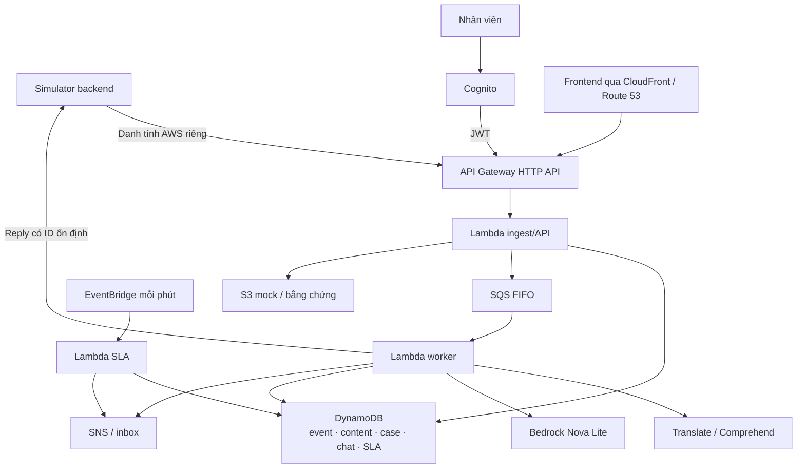

# Project Specification — Brand Listening and Crisis Alert

| Thuộc tính | Nội dung |
| --- | --- |
| Bộ tài liệu | BRD 2.0 — sản phẩm v0.1 |
| Cập nhật | 08/10/2026 |
| Nguồn yêu cầu | [BRD](BRD.md), [DATA_SOURCE](DATA_SOURCE.md), [GLOSSARY](GLOSSARY.md) |
| Mục tiêu | Hai luồng đầu cuối: cảnh báo nguy cơ và trả lời DM bằng AI |
| Nguồn lực | 5 thành viên; 6–8 giờ/người/tuần; 150–200 giờ công trong 5 tuần chính |
| Ngân sách | 200 USD tổng; kế hoạch ≤160 USD, dự phòng 40 USD |
| Hạn nộp/trình bày | 29/11/2026 |

## I. Terminology and Scope

*Phạm vi thực hiện và thuật ngữ tổ chức dự án.*

### 1. Abbreviations — Chữ viết tắt

| Ký hiệu | English expansion | Ý nghĩa |
| --- | --- | --- |
| BRD | Business Requirements Document | Yêu cầu nghiệp vụ |
| AI / LLM | Artificial Intelligence / Large Language Model | Phân tích AI / mô hình ngôn ngữ lớn |
| API / JSON | Application Programming Interface / JavaScript Object Notation | Giao diện / dữ liệu trao đổi |
| DM | Direct Message | Tin nhắn riêng |
| SLA / SLO | Service Level Agreement / Service Level Objective | Mức dịch vụ / mục tiêu |
| AWS | Amazon Web Services | Nền tảng triển khai |
| IAM | Identity and Access Management | Phân quyền AWS |
| JWT | JSON Web Token | Token xác thực |
| FIFO | First In, First Out | Thứ tự trong nhóm |
| DLQ | Dead-Letter Queue | Hàng đợi lỗi |
| S3 / SQS / SNS | Simple Storage Service / Simple Queue Service / Simple Notification Service | Lưu đối tượng / hàng đợi / thông báo |
| CMO / CEO | Chief Marketing Officer / Chief Executive Officer | Cấp quản lý nghiệp vụ |
| PIC | Person in Charge | Người phụ trách chính |
| WBS / PM | Work Breakdown Structure / Project Management | Phân rã công việc / quản lý dự án |
| USD | United States Dollar | Đơn vị ngân sách |
| PS-DL / PS-DG | Project Specification Deliverable / Diagram | Mã sản phẩm / sơ đồ |

### 2. Product Envelope — Phạm vi sản phẩm

| Thành phần | Kết quả |
| --- | --- |
| Dữ liệu | 10 khách, 10 bài/100 comment, 10 DM; một thương hiệu giả |
| Giám sát | Translate/Comprehend, quy tắc có căn cứ, cảnh báo/vụ việc |
| Hội thoại | Bedrock Nova Lite, chính sách mock, reply và bàn giao |
| Trách nhiệm | Năm cấp, CMO tùy chọn; hạn nhận và xử lý riêng |
| Hạ tầng | Core serverless; đủ danh mục bằng tác vụ minh chứng có ý nghĩa |
| Bàn giao | Hai luồng, quyền/lỗi/SLO, bằng chứng AWS, chi phí và demo |

## II. Architecture and Ownership

*Một hợp đồng tích hợp, phân module theo đầu ra; thành viên làm frontend/backend trong module của mình.*

### 1. Core Architecture — Kiến trúc core

*PS-DG-01: Core architecture — Log và chỉ số đưa về CloudWatch; dữ liệu trạng thái nằm ở DynamoDB.*

### 2. Module Owners — Phụ trách module

| Thành viên | PIC | Phối hợp |
| --- | --- | --- |
| Long Trần | Kiến trúc/core AWS, simulator; điều phối minh chứng | Mỗi thành viên cung cấp tác vụ/bằng chứng module |
| Khoa | Translate/Comprehend, quy tắc AI, Bedrock và kiểm tra tiếng Việt/đầu ra | Nam review nghiệp vụ, Huy hợp đồng |
| Long Đô — Nguyễn Hoàng Long | Cognito/IAM, API, ma trận quyền và thử vượt quyền | Long Trần hạ tầng, Nam/Huy module |
| Nam | Giám sát/cảnh báo/vụ việc, điều phối yêu cầu | Huy tích hợp; cùng Huy tổng hợp chi phí |
| Huy | API/JSON, hội thoại/SLA | Nam tích hợp; cùng Nam tổng hợp chi phí |

### 3. Contract and Runtime — Hợp đồng và xử lý

| Thành phần | Quy định |
| --- | --- |
| Nguồn chuẩn | Event Contract tại BRD VII; Huy quản lý phiên bản, nhóm cùng review |
| Request | Envelope đầy đủ; bốn trường time/user_id/msg_id/msg_content trong payload |
| Validation | Schema trước queue; quyền/quan hệ/phiên bản tại backend |
| Tiếp nhận | 202 sau lưu bền vững và xếp hàng; không đồng nghĩa AI hoàn tất |
| Queue | FIFO riêng nhóm giám sát và hội thoại; chống trùng ứng dụng suốt run |
| Lỗi | Tối đa 3 lần xử lý tự động rồi DLQ; replay có kiểm soát |
| Output | request_id/status/data/error; trạng thái sự kiện theo BRD VII.6 |
| Reply | Kiểm tra chính sách, lưu trước gửi; retry dùng cùng reply_id và nội dung |
| SLA | Kiểm tra mỗi phút; cập nhật giao/nhận/chuyển có điều kiện |

## III. Deliverables and Quality

*Mỗi task lớn có một sản phẩm bàn giao cụ thể.*

### 1. Deliverable Register — Sản phẩm bàn giao

| ID | Sản phẩm | PIC / phối hợp | Điều kiện hoàn thành |
| --- | --- | --- | --- |
| PS-DL-17 | Bộ yêu cầu | Nam; nhóm review | BRD và tài liệu liên quan nhất quán |
| PS-DL-18 | Hợp đồng API/JSON | Huy; các module review | Event/output/lỗi/quan hệ/retry đủ tích hợp |
| PS-DL-19 | Simulator và dữ liệu | Long Trần | 120 đầu vào, replay, hiển thị reply |
| PS-DL-20 | Hai luồng AI | Khoa | Phân tích và DM thật; lỗi/bàn giao rõ |
| PS-DL-21 | Core backend/AWS | Long Trần; Nam/Huy module | API→Lambda→queue→AI/data/UI |
| PS-DL-22 | Giám sát/vụ việc | Nam; Huy phối hợp | Feed/cảnh báo/giao nhận/xử lý/đóng |
| PS-DL-23 | Hội thoại/SLA | Huy; Nam phối hợp | DM/reply, hạn/quá hạn/chuyển và lịch sử |
| PS-DL-24 | Security | Long Đô | Cognito/API/quyền và tác vụ đúng/sai |
| PS-DL-25 | Minh chứng AWS/chi phí | Long Trần điều phối; Huy và Nam tổng hợp chi phí | Đủ dịch vụ, tác vụ có đầu ra và chi phí |
| PS-DL-26 | Demo/bản nộp | Nam điều phối; nhóm | AC-S01…12, slide, bản xuất và demo dự phòng |

*BR-S và AC-S truy vết về BRD. PS-DL-17…26 giữ mã sản phẩm hiện hành; không áp lại danh mục đầu việc v1.0 đã thay.*

### 2. Verification Targets — Mục tiêu kiểm tra

| Nhóm | Điều kiện |
| --- | --- |
| Dữ liệu | 10 bài/100 comment/10 DM, đúng user/cha/hội thoại; event/version/reply đếm riêng |
| Cảnh báo | Bình thường/đơn lẻ/tập thể/cáo buộc/ngoại lệ có căn cứ |
| DM | Sinh trong dữ kiện, đúng người; ngoài phạm vi/lỗi có bàn giao |
| Quyền | Backend từ chối vượt quyền, khách khác nhân viên |
| SLA | 5/10/15/30/60 phút, có/không CMO, CEO, nhận đồng thời timeout |
| SLO | Phát hiện P95 ≤30 giây; SNS P95 ≤10 giây; DM P95 ≤30 giây; UI P95 ≤3 giây; chuyển cấp ≤90 giây sau hạn |
| Toàn vẹn | Retry/edit/engagement/version cũ và vòng lặp chatbot |
| Báo cáo | Mốc server, số mẫu/lỗi/chưa xong; không dùng clock mô phỏng làm hiệu năng thực |

## IV. Cost and Schedule

*Chi phí core, AI và minh chứng dịch vụ được tổng hợp chung.*

### 1. Cost Controls — Kiểm soát chi phí

| Nội dung | Quy định |
| --- | --- |
| Tổng | 200 USD; kế hoạch ≤160, dự phòng 40 |
| Bedrock | ≤10 USD trong kế hoạch; Nova Lite On-Demand, giới hạn token/lượt gọi |
| Tổng hợp | Huy và Nam; chủ module cung cấp cấu hình, số lượt và lịch sống |
| Theo dõi | Mốc 100/140/160 USD; rà trước phát sinh thêm ở mốc 160 |
| Tài khoản/Region | AWS thông thường; us-east-1 chính, dịch vụ toàn cầu ghi riêng |
| Minh chứng | Dịch vụ ngoài core chạy tác vụ ngắn có dữ liệu dự án; không giữ máy/database chạy suốt |
| Phiên | Mặc định 2 giờ; kiểm tra tài nguyên trước/sau và ghi gia hạn |
| Dọn cuối | Xuất bằng chứng; sau nghiệm thu cuối và nhóm xác nhận không cần demo lại |

### 2. Milestones — Các mốc

| Thời gian | Đầu ra ưu tiên |
| --- | --- |
| 09/10–15/10 | Contract, dữ liệu/chính sách, core nhận/lưu/xếp hàng, quyền dịch vụ |
| 16/10–22/10 | Feed và giám sát/cảnh báo đầu cuối |
| 23/10–29/10 | Bedrock/DM/bàn giao và quyền |
| 30/10–05/11 | SLA/security/lỗi và minh chứng AWS |
| 06/11–12/11 | Đo/kiểm tra/sửa và demo hoàn chỉnh |
| 13/11–19/11 | Dự phòng |
| 20/11–28/11 | Báo cáo/diễn tập |
| 29/11/2026 | Nộp/trình bày |

## V. Document and Task Governance

*Yêu cầu, phân công và bằng chứng được quản lý nhất quán trong repo nhóm.*

### 1. Repository and Review — Tài liệu và review

| Nội dung | Quy định |
| --- | --- |
| Vị trí bàn giao | Markdown trong outputs của workspace; vào repo nhóm đặt tài liệu ở docs, AGENTS ở phạm vi áp dụng phù hợp |
| Nguồn nghiệp vụ | BRD; thuật ngữ tại GLOSSARY; dữ liệu tại DATA_SOURCE; nguyên tắc AI tại AGENTS |
| Review | Người phụ trách review, tối đa hai vòng AI review tài liệu; nhóm thống nhất theo workflow |
| Baseline | Nhóm duyệt theo quy trình; duyệt yêu cầu không thay nghiệm thu phần mềm |
| Kết quả kiểm tra | Ghi riêng PASS/FAIL, log, chi phí và sai lệch; không đánh dấu trước khi chạy |

### 2. Task Management — Quản lý đầu việc

| Nội dung | Quy định |
| --- | --- |
| Công cụ | Excel PM, sheet TASKS |
| Cột | WBS, TASK, PRIORITY, STATUS, PIC, SUPPORT, START, END |
| Đơn vị task | Một sản phẩm cụ thể, có PIC và điều kiện hoàn thành |
| Phụ thuộc | Contract/dữ liệu trước tích hợp; quyền model trước demo; bằng chứng trước dọn |
| Thay đổi nghiệp vụ | Phân tích và MCQ/khuyến nghị trước sửa; bản hoàn chỉnh chỉ giữ yêu cầu có hiệu lực |
