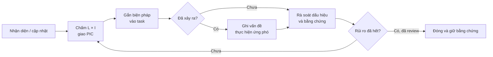

# Risk Management — Quản lý rủi ro dự án

| Thuộc tính | Nội dung |
| --- | --- |
| Sản phẩm | Brand Listening and Crisis Alert — v0.1 |
| Cơ sở | [BRD 2.0](BRD.md), [PROJECT_SPEC](PROJECT_SPEC.md), [DATA_SOURCE](DATA_SOURCE.md) |
| Cập nhật | 08/10/2026 |
| Điều phối | Nam; chủ module quản lý rủi ro thuộc phần phụ trách |
| Nguồn lực | 5 người; 5 tuần chính; 200 USD tổng; nộp/trình bày 29/11/2026 |
| Trạng thái | Danh sách khởi tạo phục vụ review nhóm; điểm số là đánh giá ban đầu |

## I. Purpose and Scope — Mục đích và phạm vi

### 1. Terminology — Thuật ngữ và chữ viết tắt

| Ký hiệu / thuật ngữ | English expansion / name | Ý nghĩa |
| --- | --- | --- |
| RM | Risk Management | Quản lý rủi ro |
| BRD | Business Requirements Document | Tài liệu yêu cầu nghiệp vụ |
| RISK | Risk | Mã rủi ro, dạng RISK-01 |
| L / I / S | Likelihood / Impact / Score | Khả năng / tác động / điểm ưu tiên |
| PIC | Person in Charge | Người phụ trách chính |
| AI / LLM | Artificial Intelligence / Large Language Model | Trí tuệ nhân tạo / mô hình ngôn ngữ lớn |
| AWS / IAM | Amazon Web Services / Identity and Access Management | Nền tảng AWS / quản lý danh tính và quyền |
| API / JSON | Application Programming Interface / JavaScript Object Notation | Giao diện tích hợp / định dạng dữ liệu |
| DM | Direct Message | Tin nhắn riêng |
| SLA / SLO | Service Level Agreement / Service Level Objective | Mức dịch vụ / mục tiêu dịch vụ |
| P95 | 95th Percentile | Phân vị 95 |
| DLQ / SNS | Dead-Letter Queue / Simple Notification Service | Hàng đợi lỗi / dịch vụ thông báo |
| CMO / CEO | Chief Marketing Officer / Chief Executive Officer | Cấp quản lý nghiệp vụ |
| USD | United States Dollar | Đơn vị ngân sách |
| AC-S | Acceptance Criterion — Simplified Scope | Mã tiêu chí nghiệm thu trong BRD |
| Risk / Issue | Risk / Issue | Việc có thể xảy ra / vấn đề đã xảy ra cần xử lý |
| Residual risk | Residual risk | Rủi ro còn lại sau khi áp dụng biện pháp |

### 2. Management Boundary — Phạm vi quản lý

| Nội dung | Quy định |
| --- | --- |
| Mục đích | Phòng ngừa trễ hạn, vượt chi phí, sai chức năng và thiếu bằng chứng nghiệm thu |
| Đối tượng | Tiến độ, nhân lực, AWS, dữ liệu, tích hợp, AI, bảo mật và demo |
| Phân biệt nghiệp vụ | Khủng hoảng thương hiệu là đối tượng phần mềm giám sát; không phải danh sách rủi ro thực hiện dự án |
| Phạm vi giữ nguyên | Một thương hiệu; 10 bài, 100 comment, 10 DM; hai luồng AI và đủ danh mục AWS |
| Quan hệ với BRD | RM hỗ trợ kế hoạch/kiểm thử; không tự thay yêu cầu, SLA, ngân sách hoặc tiêu chí nghiệm thu |
| Mức độ | HIGH/MEDIUM/LOW trong RM là ưu tiên quản lý dự án, khác LOW/MEDIUM/CRITICAL của cảnh báo sản phẩm |

## II. Risk Assessment — Đánh giá rủi ro

### 1. Assessment Scale — Thang đánh giá

| Điểm | L — Khả năng | I — Tác động |
| --- | --- | --- |
| 1 | Ít khả năng trong phạm vi demo; phụ thuộc ít | Cục bộ, sửa trong module; không ảnh hưởng mốc tích hợp |
| 2 | Có khả năng do phụ thuộc hoặc phần chưa kiểm chứng | Cần phối hợp, làm lại hoặc ảnh hưởng một mốc trung gian |
| 3 | Dễ xảy ra nếu thiếu biện pháp; nhiều phụ thuộc | Đe dọa hai luồng chính, bảo mật, quỹ 200 USD hoặc hạn nộp |

| S = L × I | Ưu tiên | Cách xử lý |
| --- | --- | --- |
| 6–9 | HIGH — Cao | Đưa vào kế hoạch gần nhất; báo Nam khi có dấu hiệu kích hoạt |
| 3–4 | MEDIUM — Vừa | Gắn biện pháp vào task module; rà soát hằng tuần |
| 1–2 | LOW — Thấp | Theo dõi; cập nhật khi điều kiện thay đổi |

*Điểm ban đầu chưa phản ánh hiệu quả biện pháp chưa thực hiện. Chỉ giảm điểm sau khi có bằng chứng; không dùng điểm số để bỏ yêu cầu bắt buộc.*

## III. Risk Register — Danh sách rủi ro

### 1. Risk Identification and Ownership — Nhận diện và phụ trách

| ID | Rủi ro / nguyên nhân | Tác động chính | L | I | S / ưu tiên | PIC / phối hợp | AC-S |
| --- | --- | --- | ---: | ---: | --- | --- | --- |
| RISK-01 | Quyền, điều kiện tài khoản hoặc quota AWS chưa đủ | Chặn AI/core hoặc minh chứng dịch vụ | 2 | 3 | 6 / HIGH | Long Trần / Long Đô | 03, 12 |
| RISK-02 | Tài nguyên quên dọn, retry hoặc phiên thử làm tăng phí | Vượt quỹ 200 USD | 2 | 3 | 6 / HIGH | Huy và Nam / chủ module | 12 |
| RISK-03 | Mở rộng tính năng, đánh giá thấp khối lượng danh mục AWS | Trễ năm tuần chính, thiếu luồng đầu cuối | 3 | 3 | 9 / HIGH | Nam / cả nhóm | 12 |
| RISK-04 | Core AWS/simulator phụ thuộc một người; thành viên bận | Nghẽn tích hợp và bàn giao | 2 | 3 | 6 / HIGH | Long Trần / Nam | 01, 02, 12 |
| RISK-05 | Simulator, frontend và backend dùng khác Event Contract | Không tích hợp được, sai quan hệ/trạng thái | 2 | 3 | 6 / HIGH | Huy / Long Trần, Nam | 01, 02, 10 |
| RISK-06 | Dữ liệu thiếu/sai quan hệ hoặc gold/mock lọt vào AI thật | Demo sai; bằng chứng AI không hợp lệ | 2 | 3 | 6 / HIGH | Long Trần / Khoa | 01, 03, 04 |
| RISK-07 | Dịch/sentiment tiếng Việt hoặc quy tắc ngữ cảnh sai | Bỏ sót nguy cơ hoặc cảnh báo nhầm | 2 | 3 | 6 / HIGH | Khoa / Nam | 03, 04 |
| RISK-08 | LLM bịa dữ kiện, sai JSON hoặc làm theo chỉ dẫn trong DM | Gửi câu trả lời sai/cam kết vượt quyền | 2 | 3 | 6 / HIGH | Khoa / Huy, Long Đô | 08, 09 |
| RISK-09 | Retry, edit, engagement hoặc clock xử lý sai | Đếm trùng, gửi trùng, sai cửa sổ cảnh báo | 2 | 3 | 6 / HIGH | Huy / Nam, Long Trần | 04, 10 |
| RISK-10 | Nhầm mức cảnh báo với SLA; timeout và nhận việc tranh chấp | Chuyển sai cấp, mất vi phạm hoặc sai báo cáo | 2 | 3 | 6 / HIGH | Huy / Nam | 05, 07 |
| RISK-11 | Backend thiếu kiểm tra quyền/đối tượng; lộ credentials | Truy cập sai case/chat hoặc quyền AWS | 2 | 3 | 6 / HIGH | Long Đô / Nam, Huy | 06 |
| RISK-12 | Worker/model/SNS lỗi; thông báo hoặc reply chưa rõ kết quả | Mất theo dõi, bàn giao chậm hoặc gửi lặp | 2 | 3 | 6 / HIGH | Huy / Khoa, Nam, Long Trần | 02, 09, 10 |
| RISK-13 | Queue, lời gọi AI và truy vấn UI chậm | Không đạt mục tiêu thời gian | 2 | 2 | 4 / MEDIUM | Huy / Khoa, Nam | 11 |
| RISK-14 | Thiếu bằng chứng dịch vụ hoặc môi trường demo hỏng | Không chứng minh đủ yêu cầu khi trình bày | 2 | 3 | 6 / HIGH | Long Trần / Nam, cả nhóm | 03, 12 |

*Mã AC-S trong bảng rút gọn phần số: 03 tương ứng AC-S03. Toàn bộ rủi ro khởi tạo ở trạng thái OPEN; chưa ghi nhận biện pháp nào đã hoàn thành.*

### 2. Prevention and Contingency — Phòng ngừa và ứng phó

| ID | Dấu hiệu kích hoạt | Phòng ngừa | Khi xảy ra / bằng chứng cần giữ |
| --- | --- | --- | --- |
| RISK-01 | Tác vụ thử bị từ chối, thiếu quota hoặc không truy cập model | Thử quyền core/AI và rà danh mục ngay tuần 09–15/10 | PIC xử lý quyền/quota; báo phần bị chặn; giữ lỗi. Đổi dịch vụ/model phải trao đổi yêu cầu |
| RISK-02 | Chạm mốc 100/140/160 USD hoặc dự báo vượt kế hoạch | Huy–Nam đối soát; phiên 2 giờ; giới hạn lượt/token/retry; chủ module ghi lịch sống | Rà chi phí trước chạy thêm; xuất rồi dọn tài nguyên thừa. Dự phòng 40 USD không tự tăng tổng quỹ |
| RISK-03 | Trễ đầu ra tuần hoặc phát sinh việc ngoài BRD | Giữ hai luồng chính; tách task có sản phẩm; đưa cả minh chứng AWS vào kế hoạch | Điều phối lại phụ thuộc, dùng tuần dự phòng; không tự bỏ dịch vụ hoặc đổi AC-S |
| RISK-04 | Task phụ thuộc chờ người, người khác không thể chạy lại | Runbook/cấu hình trong repo; review chéo; chia minh chứng theo module | Nam điều phối người hỗ trợ; bàn giao bước chạy, lỗi và quyền cần thiết, không chia sẻ secret |
| RISK-05 | Fixture/request bị từ chối hoặc module diễn giải trường khác nhau | Huy giữ contract; cùng review JSON mẫu, lỗi và version trước tích hợp | Đối soát request/log; sửa bên lệch nguồn chuẩn; chạy lại ca hợp lệ và không hợp lệ |
| RISK-06 | Không đủ 120 đầu vào; sai cha/user; runtime có gold/mock | Kiểm manifest và quan hệ; tách fixture kỳ vọng khỏi request runtime | Sửa dữ liệu; chạy run mới; giữ kết quả cũ và xác định lại bằng chứng bị ảnh hưởng |
| RISK-07 | Ca bình thường/tập thể/cáo buộc cho kết quả sai | Thử tiếng Việt sớm; giữ bản gốc/dịch, sentiment và N/K; review phủ định/ngữ cảnh | Phân tích lỗi, sửa trong quy tắc đã duyệt; thay ngưỡng phải trao đổi; không ép AI theo đáp án |
| RISK-08 | Sai schema/policy_refs; bịa đơn hàng, hoàn tiền hoặc xử lý cáo buộc | Chính sách mock có phiên bản; backend kiểm đầu ra; thử DM ngoài phạm vi/chỉ dẫn nhúng | Chặn reply không hợp lệ; dùng fallback và bàn giao; giữ lỗi/input/output phù hợp quy tắc dữ liệu |
| RISK-09 | N/K tăng khi resend/edit; trùng case/reply; event cũ kéo clock lùi | Chống trùng suốt run; cập nhật có điều kiện; tách clock; thử retry/edit/phiên bản cũ | Đối soát event/content/reply; giữ bằng chứng; sửa và phát lại có kiểm soát, không đổi ID để né lỗi |
| RISK-10 | Dashboard đánh dấu sai hạn; chuyển khi đã nhận; CEO lặp | Tách mức nguy cơ và SLA; kiểm hạn nhận/xử lý, có/không CMO, nhận đồng thời timeout | Đối soát mốc server/lịch sử; sửa giao/nhận có điều kiện; kiểm lại luồng và hiển thị vi phạm |
| RISK-11 | API cho thao tác sai vai trò/đối tượng hoặc secret xuất hiện | Kiểm quyền phía backend; tách khách/nhân viên/admin; danh tính AWS riêng cho simulator | Thu hồi quyền/credentials bị lộ; giới hạn truy cập; xác định phạm vi và kiểm lại ca vượt quyền |
| RISK-12 | Event kẹt/lỗi, có DLQ, SNS lỗi hoặc reply chưa rõ đã gửi | Trạng thái từng bước; retry hữu hạn; reply ID ổn định; inbox giữ nghĩa vụ nhận việc | Xem lỗi/DLQ; phát lại có kiểm soát; đối soát trước resend; giữ lỗi thật và bàn giao theo BRD |
| RISK-13 | Đo thực vượt mục tiêu hoặc có nhiều mẫu chưa xong | Đo sớm hai luồng; tách queue/model/UI; ghi số mẫu, lỗi và mốc server | Tối ưu đoạn nghẽn, đo lại trên cùng phạm vi; không thay SLA bằng timer demo hoặc bỏ mẫu lỗi |
| RISK-14 | Dịch vụ chỉ có ảnh console; thiếu đầu ra/chi phí; diễn tập lỗi | Lưu đầu vào→thực thi→đầu ra→chi phí; xuất trước dọn; diễn tập gói nộp | Dùng log/video/bản xuất có nhãn làm dự phòng; ghi phần chưa chứng minh; không gọi mock là AI thật |

## IV. Review and Escalation — Rà soát và xử lý

### 1. Review Workflow — Quy trình theo dõi

*RM-DG-01: Risk Management Diagram — Chu trình quản lý rủi ro. PIC xử lý trong module; Nam điều phối tác động liên module.*

### 2. Review and Update Rules — Quy tắc cập nhật

| Nội dung | Cách thực hiện |
| --- | --- |
| Chu kỳ | Rà hằng tuần cùng tiến độ; rà thêm khi đổi cấu hình, trễ mốc hoặc trước demo |
| Chủ rủi ro | PIC cập nhật dấu hiệu, biện pháp và bằng chứng; người phối hợp hỗ trợ phần phụ thuộc |
| Khi kích hoạt | PIC báo Nam trong phiên làm việc phát hiện; ghi vấn đề và task xử lý, không chờ buổi rà tuần |
| Tác động ngân sách | Huy–Nam tổng hợp ảnh hưởng; áp dụng mốc kiểm soát và giới hạn tại BRD VIII.2 |
| Tác động yêu cầu | Nhóm trao đổi trước khi thay phạm vi, model, ngưỡng, SLA, AC-S hoặc ngân sách; RM không thay BRD |
| OPEN | Rủi ro còn hiệu lực; biện pháp chưa hoàn tất hoặc chưa có bằng chứng |
| MONITORING | Đã áp dụng biện pháp, đang theo dõi hiệu quả và rủi ro còn lại |
| OCCURRED | Rủi ro đã xảy ra; liên kết task xử lý vấn đề và giữ dấu vết |
| CLOSED | Nguyên nhân/phạm vi rủi ro đã hết và được review; hết lỗi một lần chưa đủ để đóng |
| Mở lại | Khôi phục OPEN khi nguyên nhân tái xuất hiện; giữ cùng mã và bằng chứng trước đó |
| Cập nhật mỗi mã | Trạng thái, ngày rà gần nhất, hành động/task, người làm, hạn hành động, bằng chứng và L/I/S hiện hành |
| Truy vết | Mã RISK trong task Excel PM; kết quả kiểm tra theo AC-S của BRD; không lập thêm nhật ký trao đổi |

*Điểm ưu tiên rủi ro phục vụ điều phối; không thay thời hạn SLA của sản phẩm hoặc xác nhận dự án đã đạt nghiệm thu.*
